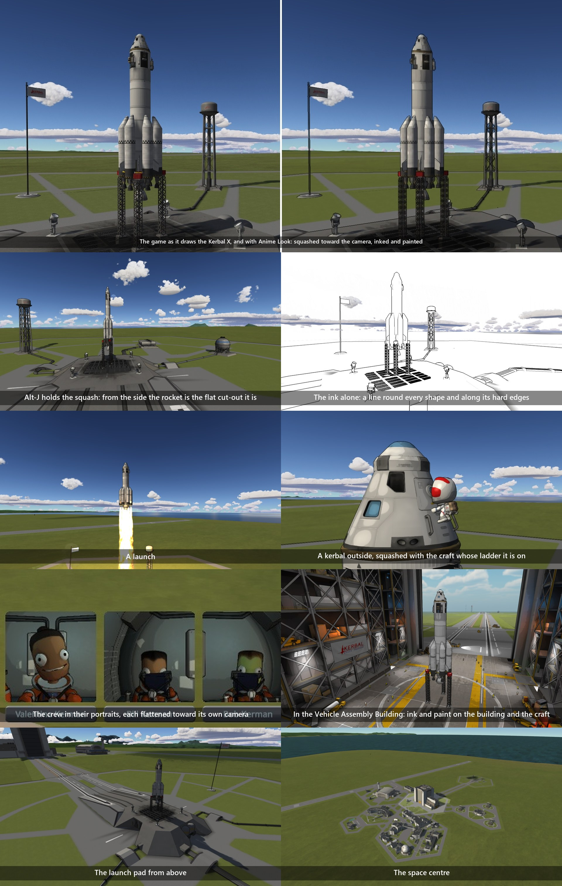
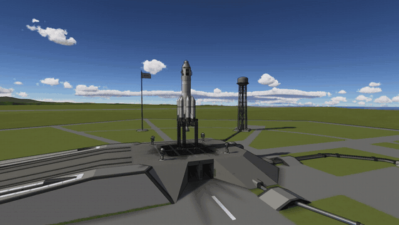
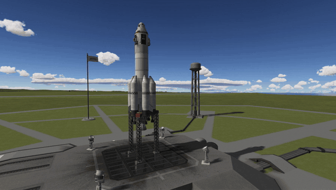
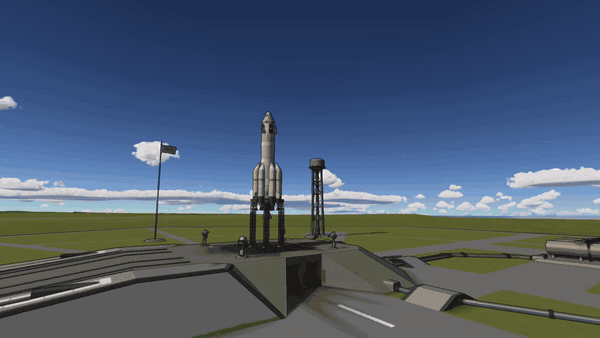
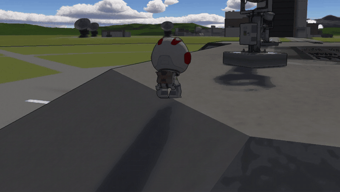

# Anime Look

Every craft and kerbal squashed flat toward the camera, as the 3D models of drawn animation are, with ink lines and
flat paint over the picture.

Anime made with 3D models has a trick: the model is not the shape it seems. In Blender a lattice that turns to face
the camera flattens a character's head, or all of it, along the line from the camera
([80 Level on Eit Mitsufuchi's *Dust of the Simulacrum*](https://80.lv/articles/this-3d-character-is-actually-flat-it-s-crazy);
DillonGoo Studios' Flattice does it as a tool). From where the camera stands nothing looks flat. What goes is the
perspective *inside* the model: the near side no longer looms and the far side no longer shrinks, so it reads as a
flat drawing that turns as the camera goes round it, in a scene that keeps its depth.

This mod does that to every craft and every kerbal in flight, every frame.

For Kerbal Space Program 1.12.x. **Needs [Keystone](https://github.com/IshiakiZ/ksp-keystone)**, a separate download
([on SpaceDock](https://spacedock.info/mod/4665/Keystone)): this mod does not load without it.

## What it does

* **The squash.** Each craft and each kerbal is flattened along the line from the camera to its own middle, to a fifth
  of its depth as installed. A kerbal on a ladder is squashed with the craft it is on. A craft on the ground is
  flattened level only, so that it stands where it stood; the full squash comes in as it climbs away.
* **Flames and smoke.** The game's flames, smoke and puffs are moved with the craft they come from, so that a flame
  leaves the engine where the engine is drawn.
* **The crew.** Each kerbal inside the craft is flattened toward its own portrait's camera, about its head, which is
  the trick as anime's makers use it. The portraits are drawn in ink and paint with the rest.
* **Hold it (Alt-J).** The squash stays where the camera stood. Move the camera and you see every craft for the
  cut-out it is. Alt-J again lets go.
* **Ink.** A line round every shape and along its hard edges, on the craft and what stands near it, fading out with
  distance so that the landscape is left to its colours. Drawn on the solid things before haze, weather, smoke and
  flames are laid over them.
* **Flat paint.** The grain of every texture smoothed into flat patches of colour, and the shading drawn a little
  toward a few steps of brightness, as paint on a cel. The sky is left smooth.
* **Everywhere a craft is.** In flight, in the cockpit, in the buildings where craft are made (the building inked and
  painted with the craft) and at the space centre. Only in flight is anything squashed.

## Install

Copy the `AnimeLook` folder from the download into your KSP's `GameData`, beside `Keystone`. It is on as installed.

## Settings

In the Keystone window (the keystone button on the game's toolbar, or Alt-K), under **Anime Look**: one switch for
all of it; the squash's switch, **Depth kept** (1 untouched, 0.02 paper), the crew's switch, the flames' switch and
the hold key; **Shadows** (each craft's true shadow on the ground and none on the craft itself, as installed, or the
squashed shapes' own shadows); the ink's switch, width and strength; the paint's switch, how strongly the shading is
stepped, how many steps and how much smoothing; and how strong the colours are. In Keystone's Advanced view: how small
the squash may draw what is nearest the camera, how far off a craft is left alone, how many vertices are reshaped a
frame, how sharp an edge gets a line, how far the lines reach, and how large the paint's patches are.

## Beside other mods

Tried on Windows beside all of these at once:

* **Scatterer, EVE, TUFX, Parallax Continued, KSP Community Fixes:** nothing to say; it works.
* **Deferred:** works. (Deferred hangs a helper on the camera; this mod leaves it alone.)
* **Waterfall:** its plumes are squashed with the craft and stay on the engines.
* **Firefly:** Firefly draws the glow of re-entry round each part's true shape. While its glow shows on a craft, that
  craft keeps its depth (it eases out of the squash and back in); the ink and the paint stay.
* **Engine Flames** (of this family): its flames are volumes, not the game's particles, and are not moved with a
  squashed craft: from close behind an engine they can stand a little off from it.

## Good to know

* The craft are not changed, only how the flight camera and the portraits' cameras draw them. Physics, the map and the
  cockpit view are as they were.
* A flattened craft's own shadow would be a sliver whenever the sun is to one side. As installed each craft keeps its
  true shadow on the ground and takes no shadow itself.
* With the camera close to one end of a long craft, the squash eases off so that the near end is not drawn small.
* The game finds the part under the pointer by its true shape, not the one drawn: close to a craft a small part can be
  drawn a little off from where it is clicked. For the same reason the buildings where craft are made have the ink and
  the paint and no squash.
* A flame that points toward the camera is drawn shorter with a squashed craft than without: it is flattened with it.
  The vapour and the heat of fast flight that the game itself draws are flattened with the craft that is flown.
* The paint smooths fine marks away with the grain: thin lines painted on a floor, far off, fade.
* It costs about a millisecond a frame for a craft of 200 meshes, more while the craft turns fast before the camera.

## Works on

Windows 11 (Direct3D 11): made there, and seen on the game alone and beside the mods above: on the launch pad, in a
launch, on a kerbal on a ladder and walking, in the cockpit, in both buildings and at the space centre. Not yet seen
there: orbit, other worlds. OpenGL (Mac, Linux): the squash is the same code and has not been run; the ink and paint
are not in this version for OpenGL.

## Licence

[CC BY 4.0](LICENSE): use it, change it and pass it on as you like, as long as you credit Ishiaki and link back here.
